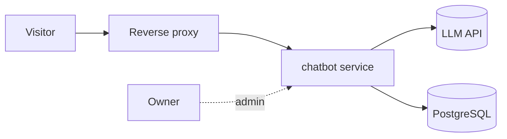
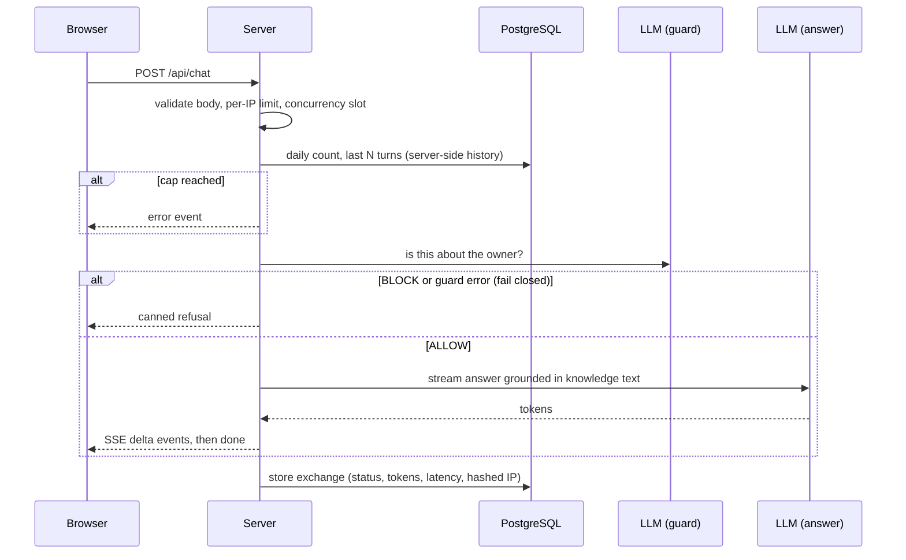
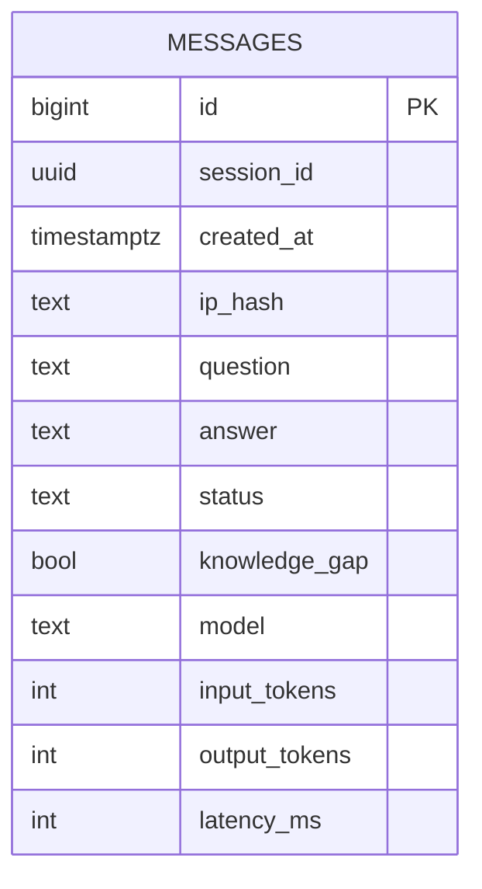

# Architecture

Current state of the `chatbot` service. Update this file in the same change as any code change that alters components, flows, limits or data (CI checks that every path mentioned here exists).

## Context

Visitors reach the service only through a reverse proxy that terminates TLS and routes requests; the service itself binds to loopback only ([ADR-0001](adr/0001-loopback-only-behind-reverse-proxy.md)). The owner reads stored conversations through a bearer-token admin endpoint.

## Components
| Path | Responsibility |
|---|---|
| `cmd/server/main.go` | Wiring (config → store → llm → server), graceful shutdown, `healthcheck` subcommand for the container |
| `internal/config/config.go` | Environment variables and defaults; secrets read from `*_FILE` paths |
| `internal/server/server.go` | HTTP routes, CORS allow-list, request log, panic recovery |
| `internal/server/ratelimit.go` | Per-IP token bucket |
| `internal/server/gapfilter.go` | Strips the leading `[GAP]` marker from the streamed answer |
| `internal/llm/llm.go` | LLM client behind an interface: `Allowed()` guard, `Stream()` answer |
| `internal/llm/prompts.go` | Guard prompt, answer prompt, refusal text |
| `internal/knowledge/knowledge.go` | Embedded knowledge text and `[[MISSING: ...]]` parsing |
| `internal/store/store.go` | pgx pool, embedded migrations, insert/history/count/list |
| `Dockerfile` | Multi-stage build, distroless, non-root |

## Chat request lifecycle

## Data

One table, `messages`: one row per exchange. A conversation is the set of rows sharing a `session_id` (no separate table); the server loads the last N rows of a session as history, so clients never supply it. `status` is `answered`, `refused` or `error`; `knowledge_gap` marks questions the bot could not answer; `ip_hash` is an HMAC, never a raw address. Indexes serve history lookups (`session_id, created_at`), recent-first listing, and a partial index on knowledge gaps. Migrations are embedded in the binary and applied on boot under an advisory lock, so concurrent starts are safe ([ADR-0004](adr/0004-embedded-migrations-advisory-lock.md)).

## Limits (defaults in `internal/config/config.go`)
500-character message, 10 turns of history, per-IP rate limit, daily exchange cap, output-token cap, concurrency cap. All are configurable; production values are set outside the code.

## Security and privacy
- Input: 8 KB body cap, strict JSON, UUID session id, UTF-8 and length checks.
- No raw IPs stored or logged; message bodies are not logged at info level.
- Secrets only through files, never plain environment variables or the repository.
- Container runs as non-root on a distroless image.

## Testing strategy
`llm.Client` and the store are interfaces; tests use fakes, so `go test -race ./...` needs no network or API key ([ADR-0003](adr/0003-interfaces-at-the-edges.md)).
